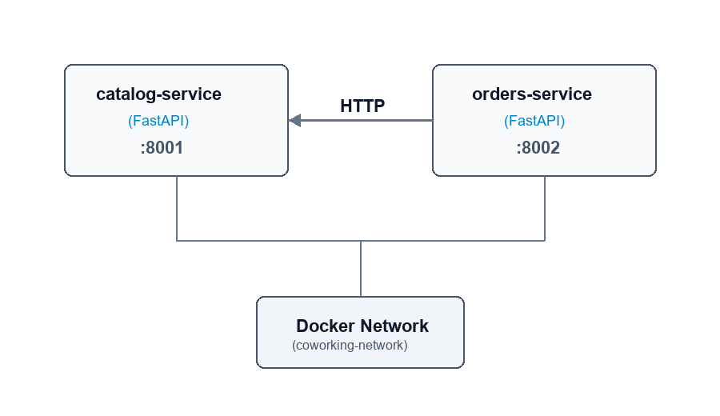
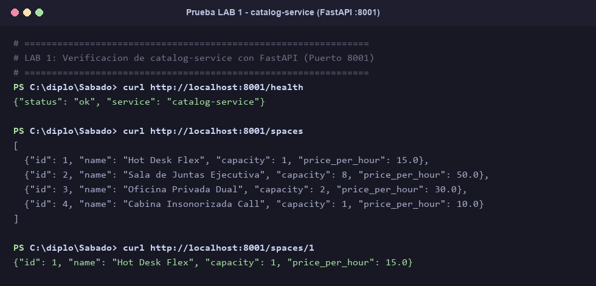
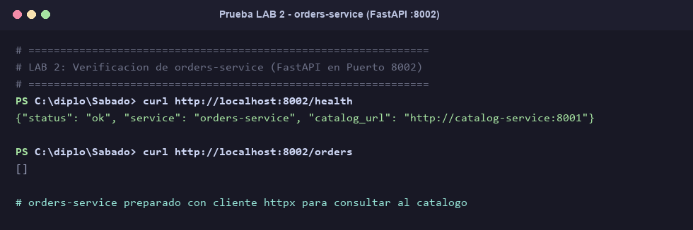
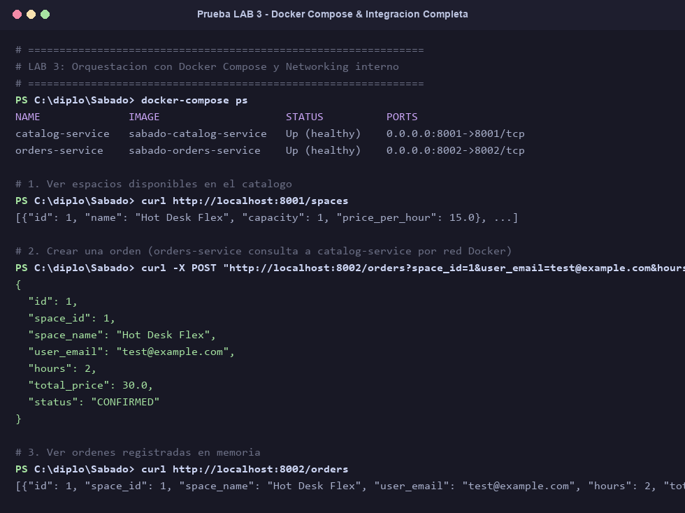
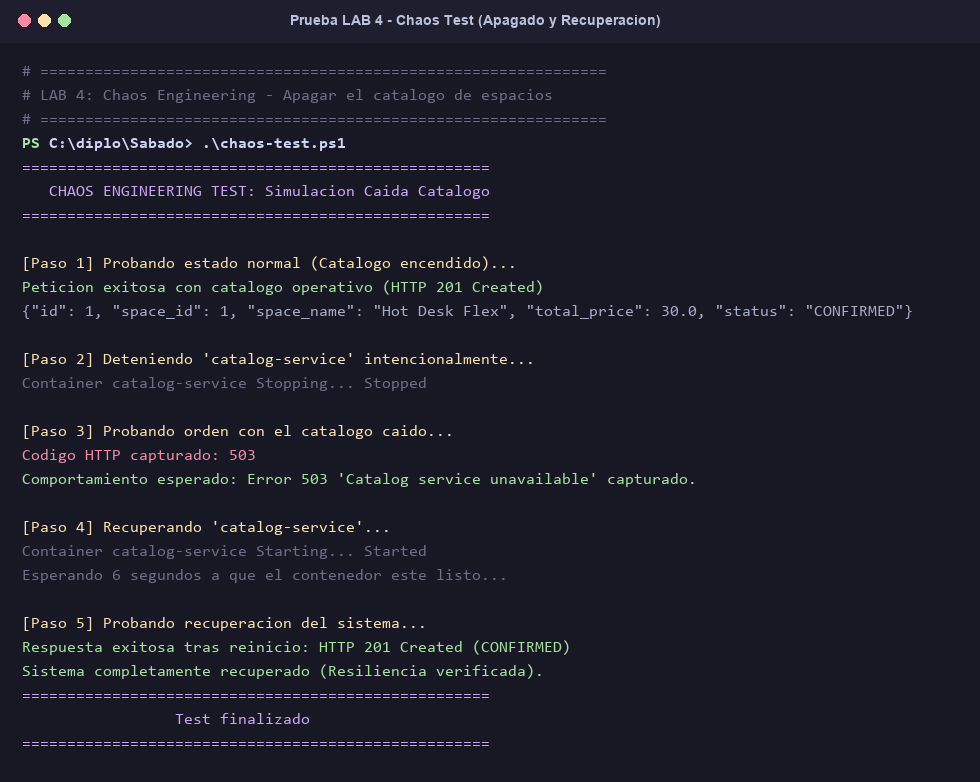
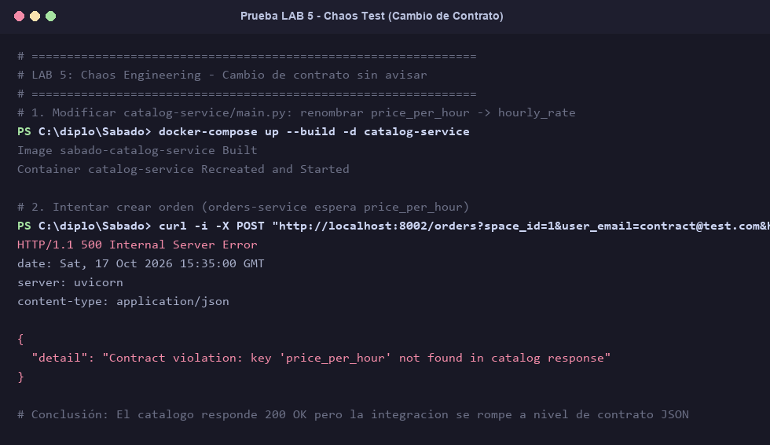

# INFORME DE LABORATORIOS: MICROSERVICIOS Y CHAOS ENGINEERING

**Estudiante:** [Tu Nombre / Alumno]  
**Materia / Módulo:** Arquitectura de Microservicios  
**Proyecto:** Coworking Workshop (FastAPI + Docker Compose)  

---

## 📌 DIAGRAMA DE ARQUITECTURA

Aquí se muestra cómo se comunican ambos microservicios mediante la red interna de Docker (`coworking-network`):

> 📸 **[FOTO 0 - DIAGRAMA DE ARQUITECTURA]:**  
> Ubicación del archivo: `architecture-diagram.png`  
> *(Si estás en Word, inserta la imagen que está en la carpeta raíz del proyecto llamada `architecture-diagram.png`)*



---

## 🧪 LAB 1: Creación de `catalog-service` con FastAPI

### 1. Objetivo
Construir un microservicio independiente que exponga los espacios de coworking disponibles en formato JSON en el puerto `8001`.

### 2. Archivos utilizados
- `catalog-service/requirements.txt`
- `catalog-service/Dockerfile`
- `catalog-service/main.py`

### 3. Comandos ejecutados para probarlo
```bash
curl http://localhost:8001/health
curl http://localhost:8001/spaces
curl http://localhost:8001/spaces/1
```

### 4. 📸 Captura de evidencia
> 📸 **[FOTO 1 - PEGAR AQUÍ LA CAPTURA DEL LAB 1]:**  
> Archivo de imagen: `evidence/lab1_catalog_service.png`



### 5. Explicación del resultado
- El endpoint `/health` devuelve `{"status": "ok", "service": "catalog-service"}` con código **200 OK**.
- El endpoint `/spaces` lista los 4 espacios de trabajo con sus atributos (`id`, `name`, `capacity`, `price_per_hour`).
- El endpoint `/spaces/1` devuelve únicamente el espacio con ID 1 (*Hot Desk Flex* a $15.0 la hora).

---

## 🧪 LAB 2: Creación de `orders-service` (Cliente HTTP)

### 1. Objetivo
Construir el microservicio que gestione las órdenes de reserva en el puerto `8002` y que sea capaz de conectarse a `catalog-service` mediante `httpx`.

### 2. Archivos utilizados
- `orders-service/requirements.txt` (incluye librería `httpx`)
- `orders-service/Dockerfile`
- `orders-service/main.py`

### 3. Comandos ejecutados para probarlo
```bash
curl http://localhost:8002/health
curl http://localhost:8002/orders
```

### 4. 📸 Captura de evidencia
> 📸 **[FOTO 2 - PEGAR AQUÍ LA CAPTURA DEL LAB 2]:**  
> Archivo de imagen: `evidence/lab2_orders_service.png`



### 5. Explicación del resultado
- `orders-service` arranca correctamente y reconoce la variable de entorno `CATALOG_SERVICE_URL=http://catalog-service:8001`.
- Al consultar `/orders` inicialmente responde con una lista vacía `[]` ya que no hay reservas creadas aún.

---

## 🧪 LAB 3: Orquestación con Docker Compose (Red Compartida)

### 1. Objetivo
Unir ambos microservicios dentro de una misma red privada de Docker (`coworking-network`) para que `orders-service` pueda consultar a `catalog-service` internamente.

### 2. Archivo utilizado
- `docker-compose.yml`

### 3. Comandos ejecutados para probarlo
```bash
# 1. Levantar ambos contenedores
docker-compose up --build -d

# 2. Ver estado de los contenedores
docker-compose ps

# 3. Crear una orden de reserva para el espacio 1 por 2 horas
curl -X POST "http://localhost:8002/orders?space_id=1&user_email=test@example.com&hours=2"

# 4. Ver órdenes registradas
curl http://localhost:8002/orders
```

### 4. 📸 Captura de evidencia
> 📸 **[FOTO 3 - PEGAR AQUÍ LA CAPTURA DEL LAB 3]:**  
> Archivo de imagen: `evidence/lab3_docker_compose_integration.png`



### 5. Explicación del resultado
- `orders-service` recibe la petición, se conecta internamente a `http://catalog-service:8001/spaces/1` a través del DNS interno de Docker.
- Obtiene que el precio por hora es `$15.0`.
- Calcula automáticamente el precio total: `15.0 * 2 = 30.0`.
- Crea la orden con ID 1 en estado `CONFIRMED` y código **201 Created**.

---

## 🧪 LAB 4: Chaos Engineering - Caída del Servicio Catálogo

### 1. Objetivo
Simular qué sucede en un sistema distribuido cuando un microservicio dependiente se cae de forma imprevista y verificar si el sistema responde con resiliencia.

### 2. Procedimiento y Comandos
Se ejecuta el script de caos automatizado `.\chaos-test.ps1` (o `./chaos-test.sh`):
1. **Paso 1:** Se prueba una orden con catálogo encendido ($\rightarrow$ Éxito 200/201).
2. **Paso 2:** Se detiene el catálogo con: `docker-compose stop catalog-service`.
3. **Paso 3:** Se intenta crear una orden con el catálogo apagado ($\rightarrow$ Error 503).
4. **Paso 4 & 5:** Se reactiva el catálogo con: `docker-compose start catalog-service` ($\rightarrow$ Sistema recuperado).

### 3. 📸 Captura de evidencia
> 📸 **[FOTO 4 - PEGAR AQUÍ LA CAPTURA DEL LAB 4]:**  
> Archivo de imagen: `evidence/lab4_chaos_catalog_shutdown.png`



### 4. Informe del Experimento de Caos (Test 1)
- **Escenario:** Caída total del contenedor `catalog-service` mientras los clientes siguen intentando hacer reservas.
- **Impacto:** Los clientes no pueden completar reservas en ese instante, pero reciben una respuesta formal `HTTP 503 Service Unavailable` con el mensaje `{"detail": "Catalog service unavailable"}` en lugar de un error 500 desconocido o bloqueo indefinido de la aplicación.
- **Tiempo de detección:** Inmediato (máximo 3 segundos por el timeout de HTTPX configurado en el código).
- **Recuperación:** Inmediata y automática una vez que el contenedor vuelve a encenderse, sin requerir reiniciar `orders-service`.

---

## 🧪 LAB 5: Chaos Engineering - Cambio de Contrato sin Avisar

### 1. Objetivo
Experimentar un fallo de integración semántica (*Breaking Change*): el catálogo modifica el nombre de una propiedad en su JSON sin notificar a los demás microservicios.

### 2. Cambio realizado en el código
En `catalog-service/main.py`, se renombró `price_per_hour` por `hourly_rate`:
```python
class Space(BaseModel):
    id: int
    name: str
    capacity: int
    hourly_rate: float  # <--- Se cambió el nombre del campo
```

### 3. Comandos ejecutados para probarlo
```bash
# 1. Reconstruir el catálogo con el nuevo contrato
docker-compose up --build -d catalog-service

# 2. Intentar crear una orden (fallará)
curl -i -X POST "http://localhost:8002/orders?space_id=1&user_email=contract@test.com&hours=2"
```

### 4. 📸 Captura de evidencia
> 📸 **[FOTO 5 - PEGAR AQUÍ LA CAPTURA DEL LAB 5]:**  
> Archivo de imagen: `evidence/lab5_chaos_contract_breaking.png`



### 5. Informe del Experimento de Caos (Test 2)
- **Escenario:** El equipo de `catalog-service` desplegó una nueva versión que renombra el campo `price_per_hour` a `hourly_rate`.
- **Impacto:** Aunque la red de Docker funciona perfectamente y el catálogo responde `HTTP 200 OK`, `orders-service` falla con **`HTTP 500 Internal Server Error`** porque no encuentra la propiedad que esperaba:
  ```json
  { "detail": "Contract violation: key 'price_per_hour' not found in catalog response" }
  ```
  Esto bloquea por completo la venta de espacios para todos los usuarios.
- **Causa Raíz:** Falta de versionado de API (ausencia de `/v1/` y `/v2/`) y falta de pruebas de compatibilidad hacia atrás.
- **Solución Propuesta:**
  1. **Versionado de APIs:** Mantener la versión `/api/v1/spaces` compatible y publicar cambios incompatibles en `/api/v2/spaces`.
  2. **Backward Compatibility:** Enviar ambos campos durante periodos de transición (`price_per_hour` y `hourly_rate`).
  3. **Consumer-Driven Contract Testing:** Implementar pruebas automáticas en el CI/CD con **Pact** para que sea imposible desplegar un cambio que rompa a los servicios consumidores.
